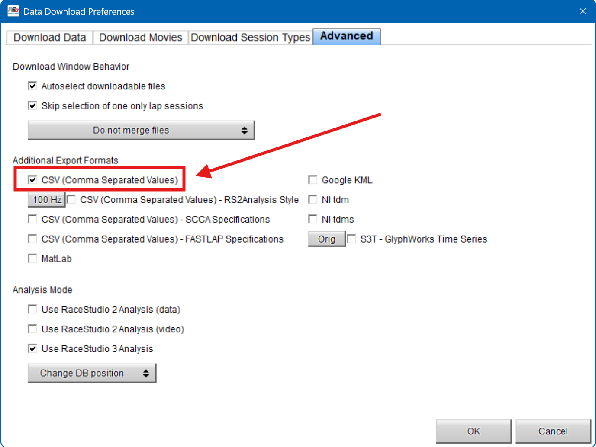

# MyChron-GPS-to-Insta360


**Vibe coded!**

Convert **MyChron** GoKart lap timer sessions into **GPX** and **FIT** files that the **Insta360 app /
Insta360 Studio "Stats Dashboard"** can overlay onto your action-cam video: speed, altitude, distance,
gradient and a track map, all synced automatically to the footage. It also writes a merged CSV for
**Telemetry Overlay**.

Drop a RaceStudio **`.xrk`** or **`.xrz`** straight in. Nothing needs exporting first, and there is
nothing extra to install: the logger format is read by the tool itself.

It also works the other way round: point it at an **Insta360 video** (`.insv` / `.lrv`) and it extracts
the **GPS and IMU** recorded by the camera into GPX, FIT and CSV for use in other apps.

A **Dragy** GPS log works too: the **`.vbo`** the Dragy Lap app exports converts into the same GPX, FIT
and Telemetry Overlay outputs.

A single Windows `.exe`, with no runtime to install. **Drag the session onto it**, or **double-click**
to pick it, or drive it from the **command line**.

## Download

⬇️ **[Latest release: `MyChron2Insta360.exe`](https://github.com/bolausson/MyChron-GPS-to-Insta360/releases/latest/download/MyChron2Insta360.exe)**.
It is a single self-contained Windows 11 binary (no .NET install needed). That link always points at the
newest build. You can also browse [all releases](https://github.com/bolausson/MyChron-GPS-to-Insta360/releases).

## Reading .xrk / .xrz directly (no CSV export needed)

RaceStudio stores each session as a single **`.xrk`** (and a compressed `.xrz`). Point the tool at one
and it reads it directly, so the "export to CSV first" step disappears. Drop the file in, or pass it on
the command line; a folder holding several is fine too.

It is also better data. Compared against a CSV export of the same session: identical channels, identical
sample times, and identical GPS fixes, but the CSV **rounds** on the way out (accelerations to 2
decimals, gyro, steering, battery and temperature to 1) while the file itself keeps full precision. The
logger file additionally carries the **GPS week number**, so the UTC clock no longer has to be inferred
from the folder path, plus the track and racer, which land in the Telemetry Overlay preamble.

**Nothing extra to install.** The reader is built in, so the single `.exe` stays a single `.exe`. AiM
publish a library for reading these files, but it is proprietary and could not be bundled with a GPLv3
project, so this tool implements the format itself. Format knowledge comes from
[libxrk](https://github.com/m3rlin45/libxrk), an independent MIT-licensed implementation, and through it
from TrackDataAnalysis by Scott Smith. See [THIRD-PARTY-NOTICES.md](THIRD-PARTY-NOTICES.md).

It is checked, not assumed. `--verify-xrk` reads a file three ways and prints the differences:

```
MyChron2Insta360 "...\Session.xrk" --verify-xrk
```

On the reference session every channel, every GPS fix and every lap comes out **identical** to AiM's own
library (same sample times to the millisecond, same values to float32 print precision), and matches the
RaceStudio CSV export to that export's rounding. The comparison against AiM's library needs their DLLs
present, via `--xrk-dll <folder>` or the `MYCHRON2INSTA360_XRK_DIR` environment variable; without them
that column is simply skipped.

One difference worth knowing: the logger records a few channels AiM's library does not hand out, such as
`Luminosity` on a MyChron 6. Those are kept, so an xrk can produce a column the CSV export does not have.
`--no-xrk` forces the CSV path. When a session exists as both a logger file and a `_CSV` folder, the
logger file wins and the session is converted once, not twice.

## Reading a RaceStudio CSV export instead (optional)

**You do not need this.** Logger files are read directly, so there is nothing to configure in
RaceStudio. This path exists because earlier versions required it, and it still works if you already
have such exports lying around, or want to convert a session whose `.xrk` you no longer have.

RaceStudio can write a **`..._CSV`** folder containing one file per channel. It is off by default;
enable it once under:

> **Preferences, Data Download Preferences, Advanced Tab, Additional Export Formats,**
> tick **"CSV (Comma Separated Values)"**



Point the tool at such a folder (or a parent folder of several) and it reads the GPS files from it:

- **`_GPS_o.csv`**: raw receiver rate (**25 Hz** on MyChron 6). *Default.*
- **`_GPS.csv`**: a 10 Hz decimation, selected with `--gps10`.

Columns: `time, itow, lat, lon, alt, speed, accuracy`, where **`itow`** is GPS time-of-week. Avoid the
single "AiM CSV" export: it resamples everything to one rate and has no true GPS time.

Two things to know if you use this path. The export **rounds** (accelerations to 2 decimals, gyro,
steering, battery and temperature to 1), so it is less precise than the logger file. And it has no GPS
week number, so the session date is taken from the folder path, RaceStudio's `data\YYYY-MM-DD\...`, or
from `--date`. Outside such a folder it comes from when the export was written, which is right as long
as that was less than a week after the session ended; otherwise give `--date`.

## Reading an Insta360 video

Drop an **`.insv`** or **`.lrv`** file in and the tool reads the camera's own metadata trailer natively
(no ExifTool or other helper needed), giving:

- **GPS** at the rate the source provided (about 10 Hz), already stamped with absolute UTC.
- **IMU**: accelerometer and gyroscope at roughly 1000 Hz.

Point it at a single video or at a whole camera folder (for example `DCIM\Camera01`). Each capture
writes a main `VID_....insv` and an `LRV_....lrv` proxy that share the same telemetry, so the two are
treated as one clip and never produce duplicate output. Clips are read in parallel.

By default every clip becomes its own output set. Tick **Merge sessions into one file** (or pass
`--merge`) to combine them onto a single timeline, named `merged-YYYYMMDD-HHMMSS`. Because every point
carries absolute UTC, this also stitches a **long recording that the camera split into several files**
back into one continuous track. The log prints the gap between consecutive clips, so you can see
whether they are one split recording or separate runs.

The X-series cameras have no built-in GPS, so a clip only contains GPS if a **GPS Preview Remote**, a
**GPS Action Remote**, or the phone app was connected **while recording**. Adding a track afterwards in
the Insta360 app is only a dashboard overlay and does not write GPS into the file. Telemetry may sit in
the `.insv` or in the matching `.lrv`, so if one comes up empty, try the other.

## Reading a Dragy .vbo

The **Dragy Lap** app exports a session as a **`.vbo`**, Racelogic's open VBOX text format, which other
loggers and lap timers write too. Drop one in, or a folder holding several, and it converts like a
MyChron session: GPX, FIT and the Telemetry Overlay CSV, with the same time nudge, rate, trim and merge
options. It can sit in the list next to MyChron sessions.

Only the GPS columns of a `.vbo` are read: position, speed, heading, height and the satellite count,
at 25 Hz from a Dragy. A Dragy has no accelerometer, so there is no IMU CSV for a `.vbo` (the log says
so), and no laps.

- **Time.** The file states UTC itself, so no GPS week or leap seconds come into it. Each row carries the
  time of day only. The date comes from the header (Dragy's "UTC Date Started", else "File created
  on"), else from `--date` on the command line, else from a date in the file name, and the log says
  which. A file that gives no date at all is refused rather than guessed: convert it on its own on the
  command line with `--date YYYY-MM-DD`. A session that runs past midnight UTC carries on into the next
  day, and a stray row whose time is out of step with its neighbours is dropped and counted in the log.
- **Several at once.** In a folder or a list of several sessions, a `.vbo` that cannot be read (no date,
  no fixes) is skipped with a note in the log and the rest still convert.
- **Telemetry Overlay.** The CSV carries speed, position and altitude as for a MyChron, plus the heading
  and the satellite count, which bind to Telemetry Overlay's gauges.
- **Height.** A Dragy reports height above sea level, a MyChron height above the GPS ellipsoid. At the
  Erzgebirgsring that is 44 m apart (it varies by place), so a Dragy and a MyChron track of the same
  circuit do not share altitudes.
- **25 Hz.** In most seconds a Dragy delivers 24 fixes and fills the 25th in by interpolation, so speed
  worked out from positions alone wobbles once a second. If a gauge that does that looks jittery,
  convert at a fixed 5 Hz.

**A `.dlap` cannot be read.** It is the Dragy app's own package, undocumented, with its data part
encrypted. Export the session as `.vbo` in the Dragy Lap app instead; the tool says so if you drop a
`.dlap` in.

## What each output holds

| Output | Contents |
|---|---|
| **GPX** | GPS track only: position, altitude, per-point speed and time. Best for maps and Insta360. |
| **FIT** | GPS track plus accelerometer and gyroscope, temperature and lap splits (where the source has them). |
| **IMU CSV** | Accelerometer (g) and gyroscope (deg/s), one row per sample. Same columns for both sources. |
| **Telemetry Overlay** | One wide CSV holding every channel the logger recorded, for goprotelemetryextractor.com. MyChron sessions, and the GPS of a `.vbo`. |

The IMU CSV is written by default; untick **IMU CSV** in the GUI or pass `--no-imu-csv` to skip it. Its
columns are `utc, elapsed_s, accel_x_g, accel_y_g, accel_z_g, gyro_x_dps, gyro_y_dps, gyro_z_dps`. Note
that each device uses its own axis directions, so MyChron and Insta360 axes are not directly comparable.

Because the Insta360 IMU runs near 1000 Hz, a full session makes a large CSV (about 70 MB for 17
minutes). Use **IMU rate (Hz)** in the GUI or `--imu-hz` to downsample, for example `--imu-hz 50`.

## Telemetry Overlay export

[Telemetry Overlay](https://goprotelemetryextractor.com/telemetry-overlay-gopro-gps) wants one wide
file, while RaceStudio exports one CSV per channel. Tick **Telemetry Overlay** (or pass
`--format telemetry-overlay`) to merge a session into a single AiM-style CSV with GPS, IMU, lap
beacons and every other channel the logger recorded on one time base.

Columns are named so they bind to Telemetry Overlay's gauges with no remapping, and **no
`remapheaders.txt` is written**: re-declaring names the app already knows makes the whole file fail to
load. The channel list is discovered, not hard-coded, so a logger with probes fitted brings its water
temperature, EGT or brake pressure along too:

- a channel whose name and units the app knows is emitted unchanged;
- a few are renamed to match (`Internal Batt` becomes `Battery`, `Water Temp` becomes
  `Coolant Temperature`), each verified against the app's own table before use;
- anything unrecognised (EGT, lambda and AFR have no entry at all) is emitted verbatim and arrives as
  an extra stream, which you reach with **Read extra streams** and a Custom gauge;
- a channel that is all zero, the signature of a sensor that is not plugged in, is dropped so you do
  not get a permanently dead gauge. A flat but non-zero channel is kept, with a warning.

Every decision is logged, so if a gauge you expected is missing the reason is in the output:

```
Internal Batt (V): bound as Battery (V), renamed to match
Logger Temperature (C): bound as Logger Temperature (°C), renamed to match
RPM: skipped, all 68477 samples are zero (sensor not connected?)
```

The **mount tilt correction applies here as well**, from the same `--tilt`. Lap beacons come from the
logger's own lap table, so Telemetry Overlay's lap timer matches it.

Signs are a preference rather than a correctness question, since every gauge that can be mirrored has
an invert box: steering is negated by default because the gauge renders it mirrored, and lateral g is
left in the "seat of the pants" sense. `--no-to-invert-steering` and `--to-invert-lateral` swap either.
`--to-rate` sets the output grid, 50 Hz by default, matching the native accel and gyro rate.

A `.vbo` gets this export too, with its GPS, heading and satellite count. It does not apply to Insta360
video input. `docs/TelemetryOverlay-CSV-Spec.md` documents the file format in full.

## Remembering your settings

The GUI starts with sensible defaults. Once you have it set up the way you like, press **Save as
default** and it comes back that way next time: output folder, which formats to write, the IMU and
output rates, tilt correction, merge and trim, and the default sources path with its tick box. **Reset**
puts the built-in defaults back, and offers to delete the saved file so the next start is clean too.

Settings live in a small ini file called **`MyChron2Insta360.ini`**, beside the program.

Put a path in the **Settings file** box to keep them somewhere else instead, which is what you want if
the program sits in a folder you cannot write to, or if you sync your configuration between machines.
Saving then writes two files: your settings where you asked for them, and a two-line pointer at the
default location:

```ini
# This program's settings live elsewhere. Edit or delete the line below to change that.
settings-file = C:\Users\you\Config-Backups\MyChron2Insta360.ini
```

That pointer is how the next start finds them, so **a desktop shortcut needs no arguments**: the lookup
uses the exe's own folder, not the working directory or wherever you launched from. Both files have to
survive; delete the pointer and it falls back to the built-in defaults, with your settings file still
sitting there unreferenced. If the pointer names a file that is not there, say on a machine where your
sync has not caught up, it says so and uses the built-in defaults rather than pretending.

The file is plain text and every key is named after the command line option it stands for, so it doubles
as a note of the equivalent command. The last two, `sources-dir` and `always-open-sources-dir`, belong
to the GUI alone:

```ini
[MyChron2Insta360]
format = gpx,fit,telemetry-overlay
imu-csv = true
out-dir = C:\telemetry-out
rate = native
imu-hz = 50
tilt = auto
merge = false
sources-dir = C:\AIM_SPORT\RaceStudio3\user\data
always-open-sources-dir = false
```

**The command line reads it too**, which makes scripting shorter: put the common options in a file and
pass only what changes. Any option you type still wins over the file. A line in it that cannot be
read, `nudge = abc` or a misspelled key say, is named in the log and ignored. `--ini <file>` picks a
different one, which has to be there, and `--no-ini` ignores it entirely, so a script can guarantee it
is unaffected. With no file present nothing changes at all.

## Mount tilt correction

A MyChron sits at an angle on the steering wheel, so it never measures level. A slice of gravity stays
permanently in the longitudinal channel (0.23 g on the test kart, which reads like braking that never
stops), and real braking, cornering and bumps get mixed between axes.

Tick **Correct mount tilt** (or pass `--tilt`) and the tool rotates the accelerometer and gyroscope so
gravity sits back on the vertical axis. Leave the angle box empty and it is measured from the data;
type an angle to use one you already know. **Autodetect** measures it and fills the box in, and
`--detect-tilt` prints the same report without converting anything.

Gravity is the only absolute reference an IMU has, so the angle is read from moments when the kart is
barely accelerating or turning. Those moments are pooled per time block and combined with a **median**,
which matters: a log usually ends with the kart parked on whatever slope it stopped on, and on the test
session that final stretch alone reads 23.5° against the 13.0° measured on track. A mean would split the
difference and be wrong by several degrees; the median ignores it.

The log states what was measured and how solid it is, and warns when the sample was poor:

```
Tilt detected: 13.0° from +Z (lean +12.9° toward X, +1.4° toward Y),
               from 1900 steady samples in 29 block(s), spread 1.3°, |g|=1.004
```

Two limits worth knowing. Gravity fixes pitch and roll but says nothing about heading, so the correction
levels the logger without rotating it about the vertical axis. And a logger clamped to the steering wheel
turns with the wheel: the tilt *angle* stays put, but the direction it leans swings as you steer, so the
correction is exact with the wheel straight and drifts slightly at full lock.

## Why this is accurate

Insta360 syncs telemetry to video **by absolute timestamp**. The `itow` column is real GPS time, so the
tool derives **exact UTC to the millisecond**. There is no timezone to configure and no guessing (the
calendar date is read from the RaceStudio folder path). A `--nudge` / *Time nudge* control remains for
trimming any residual camera-clock offset.

The nudge is in seconds, to the millisecond: `-3.452` or `-3,452`, negative to move every timestamp
earlier, positive for later. The GUI box and `--nudge` both read a dot or a comma, whatever the Windows
number format. The box shows three decimals, and what it shows is exactly what is applied. The log
states the nudge used. It applies to MyChron and `.vbo` sessions; Insta360 video is written as
recorded, and the log says so if a nudge is set.

## Multiple sessions

The MyChron starts a **new session** whenever the kart slows or stops, so one continuous video can span
several sessions (several `_CSV` folders). Point the tool at a **parent folder** and it finds them all.
Because every point has exact GPS time, they line up on one timeline automatically.

- **Default:** each session becomes its own output file.
- **Merge** (CLI `--merge` / GUI "Merge sessions into one file"): all sessions combined into a single
  output, with one GPX track segment per session so no line is drawn across the stopped gaps. Sessions
  that overlap in time, such as a MyChron and a Dragy log of the same run, are two recordings of the
  same stretch, which one merged file would show twice: the log warns, and they are better converted
  without merging.

Output names: an individual file takes its session folder's name. A merged file is
**`merged-YYYYMMDD-HHMMSS`** built from the earliest GPS timestamp (UTC). Override with `--out`, or
place the files elsewhere with `--out-dir`. A `.gpx` or `.fit` on the `--out` name is dropped and each
output adds its own, so `-o run.gpx` writes `run.gpx`, `run.fit` and `run_imu.csv`.

## Features

- Reads a MyChron **`.xrk` / `.xrz`** directly, with no external library and no CSV export step, or a
  RaceStudio `_CSV` folder, a **parent folder of several**, a `_GPS*.csv`, a **Dragy `.vbo`** GPS log,
  or an **Insta360 `.insv` / `.lrv`** video, all auto-detected.
- **Exact UTC** from GPS `itow` (MyChron), from the camera's GPS records (Insta360) or as a `.vbo`
  states it, so no timezone configuration.
- Keeps the **native rates** (GPS 25 Hz, IMU 50 Hz on MyChron, about 1000 Hz on Insta360), each with an
  optional downsample.
- Extracts **accelerometer and gyroscope**, plus **temperature** and **lap splits** from MyChron.
- Optional **mount tilt correction**, with the angle measured from the data.
- Merges a whole session into one **Telemetry Overlay** CSV, with the channel list discovered.
- Optional **merge** of multiple sessions, accuracy filter, standstill trim, and **output folder**.
- Writes **GPX 1.1** (`gpxtpx` speed), **FIT** (official Garmin SDK) and an **IMU CSV**.
- **CLI + GUI** in one binary.

## Build

Requires the **.NET 10 SDK** (`winget install Microsoft.DotNet.SDK.10`).

```powershell
# Build a single self-contained .exe (no .NET needed on the target machine)
dotnet publish src/MyChron2Insta360.App -c Release
# output: src/MyChron2Insta360.App/bin/Release/net10.0-windows/win-x64/publish/MyChron2Insta360.exe
```

## Usage

**GUI:** double-click `MyChron2Insta360.exe`, then drag folders or files onto the list, or add them with
*Add folder…* / *Add file(s)…*. *Remove* and *Clear* edit the list; nothing runs until you press *Convert*.

Those two pickers start in the **Default sources path**, RaceStudio's data folder
(`C:\AIM_SPORT\RaceStudio3\user\data`) unless you point it elsewhere: type a path, use *Browse…*, or
drop a folder on the box. They open there until you have picked something; from then on Windows reopens
them wherever you last picked from, as it does for any program. Windows keeps that memory itself, across
restarts, so changing the path does not move them. Tick **Make file picker always open this path** to
start in the default path every time instead. If the folder does not exist, they open wherever Windows
chooses and the log says so. *Save as default* keeps the path and the tick box.

**CLI:**

```powershell
MyChron2Insta360 "...\Session.xrk"                           # straight from the logger file
MyChron2Insta360 "...\Session.xrk" --verify-xrk              # check the reader against AiM's library
MyChron2Insta360 "...\Session_..._CSV"                       # a RaceStudio CSV export instead
MyChron2Insta360 "...\Casteluccio" --format both             # parent folder, one file per session
MyChron2Insta360 "...\Casteluccio" --merge --out-dir C:\out  # merge all sessions into one file
MyChron2Insta360 "...\_GPS_o.csv" --hz 10 --nudge -1.5
MyChron2Insta360 "...\VID_20260801_171316_00_005.insv" --both      # Insta360 video: GPS + IMU
MyChron2Insta360 "...\LRV_20260801_171316_01_005.lrv" --imu-hz 50  # downsample the 1 kHz IMU
MyChron2Insta360 "...\DCIM\Camera01" --both                        # every clip in a camera folder
MyChron2Insta360 "...\DCIM\Camera01" --merge --both                # all clips on one timeline
MyChron2Insta360 "...\Session_..._CSV" --detect-tilt                # just report how the logger sits
MyChron2Insta360 "...\Session_..._CSV" --both --tilt                # level the IMU, angle from the data
MyChron2Insta360 "...\Session_..._CSV" --both --tilt 13             # level it by a known 13 degrees
MyChron2Insta360 "...\Session_..._CSV" --format telemetry-overlay --tilt   # one wide CSV for Telemetry Overlay
MyChron2Insta360 "...\Session_..._CSV" --format gpx,fit,telemetry-overlay  # all three at once
MyChron2Insta360 "...\dragylap_20261024_164151_Track.vbo" --format gpx,fit,telemetry-overlay  # a Dragy log
MyChron2Insta360 "...\plain.vbo" --date 2026-10-24                  # a .vbo whose header gives no date
MyChron2Insta360 --help
```

| Option | Meaning |
|---|---|
| `--merge` | Merge all sessions into ONE output (default: one file per session) |
| `-o, --out <file>` | Explicit output path, single output only. A `.gpx` or `.fit` on it is dropped and each output adds its own: `run.gpx`, `run.fit`, `run_imu.csv` |
| `--out-dir <folder>` | Write outputs into this folder (created if needed) |
| `--format <list>` | Output format(s), comma separated: `gpx`, `fit`, `both`, `telemetry-overlay`. Default `gpx` |
| `--to-rate <hz>` | Telemetry Overlay grid rate (default 50) |
| `--no-to-invert-steering` | Keep the logged steering sign (default: negated, matching the gauge) |
| `--to-invert-lateral` | Negate lateral g (default: off, the "seat of the pants" sense) |
| `--gps10` | Use `_GPS.csv` (10 Hz) instead of `_GPS_o.csv` (25 Hz). CSV exports only |
| `--no-xrk` | Ignore `.xrk`/`.xrz` and use the RaceStudio CSV export instead |
| `--verify-xrk` | Read an `.xrk` with this tool, AiM's library and the CSV export, and report differences |
| `--ini <file>` | Read starting values from this settings file instead of the default. It has to be there |
| `--no-ini` | Ignore the settings file entirely |
| `--xrk-dll <folder>` | Where AiM's library sits, used only by `--verify-xrk` |
| `--hz <n>` | Downsample to n Hz (default, or 0: native rate) |
| `--nudge <seconds>` | Shift every timestamp to fine-tune sync, such as `-3.452`. MyChron and `.vbo` sessions only |
| `--max-accuracy <m>` | Drop fixes with reported accuracy worse than m metres (default: keep all). A `.vbo` reports none, so all its fixes are kept |
| `--date <YYYY-MM-DD>` | Override the session date (only if it isn't in the folder path). For a `.vbo`, the UTC date of its first fix, used when its header gives none |
| `--leap <n>` | GPS-UTC leap seconds for iTOW (default 18). Not used for a `.vbo`, which is UTC already |
| `--trim` | Trim leading/trailing standstill per session (off by default) |
| `--no-imu-csv` | Do not write the separate accel/gyro CSV (it is written by default) |
| `--imu-hz <n>` | Downsample the IMU to n Hz (default, or 0: native, about 1000 Hz on Insta360) |
| `--tilt [deg]` | Correct the mount tilt. No value (or `auto`) measures it; a number uses that angle. Either wins over the settings file |
| `--detect-tilt` | Only measure and print the mount tilt, then exit. Writes nothing |
| `-h, --help` | Show the built-in help |
| `--version` | Show the version |

An unknown option, a value that is missing or cannot be read, or an `--ini` file that is not there
stops with an error and converts nothing, rather than going ahead without it. Another option where a
value belongs counts as a missing value: `--out-dir --merge` is an error, not a folder called
`--merge`.

Then in the Insta360 app: **Dashboard, Data Source, Local Files, Import**.

## Project layout

```
src/
  MyChron2Insta360.Core/   XrkBinary (reads .xrk/.xrz directly, no external library),
                           XrkReader + XrkNative (optional cross-check against AiM's library),
                           MyChronSources (picks the logger file or the CSV export),
                           RaceStudioGpsCsv / RaceStudioImu / RaceStudioChannels (MyChron readers),
                           RaceStudioChannelScan (discovers whatever channels a session has),
                           Insta360Trailer (native .insv/.lrv metadata reader),
                           VboReader (Dragy and other .vbo GPS logs),
                           ItowTime (GPS to UTC), Clock (time sums exact to the tick),
                           Conversion (build/downsample),
                           TiltCorrection (mount tilt), Imu (shared sample type),
                           GpxWriter, FitWriter, ImuCsvWriter,
                           TelemetryOverlayCsv + TelemetryOverlayAliases (merged AiM CSV)
  MyChron2Insta360.App/    single .exe: CLI (Cli.cs) + WinForms GUI (MainForm.cs)
tests/                     xunit tests, including the Telemetry Overlay export end to end
docs/                      TelemetryOverlay-CSV-Spec.md and the extracted channel alias table
```

Run the tests with `dotnet test tests/MyChron2Insta360.Tests`.

Notes: the .xrk / .xrz reader is this tool's own, with its format knowledge taken from libxrk, an
MIT-licensed implementation (see THIRD-PARTY-NOTICES.md). The Insta360 trailer reader is a clean-room implementation of the
publicly documented format, with no external tool required; the layout was cross-checked against
[telemetry-parser](https://github.com/AdrianEddy/telemetry-parser) and [ExifTool](https://exiftool.org/),
and the output verified against ExifTool on real files.

## Changes

### 1.4.1

- **The time nudge in the GUI** shows milliseconds, `-3,452` rather than `-3,5`, and reads a dot or a
  comma as the decimal point. Under a German number format, `-3.452` used to read as minus three
  thousand four hundred fifty-two and land on the -600 s limit; and `-3,452` showed as `-3,5` while
  -3.452 s was applied. What the box shows is now what is applied. The Max GPS accuracy box reads
  either mark too, and the whole-number boxes keep only what they show. Every number on the command
  line and in the settings file reads either mark as well, whatever the Windows number format.
- **The log states the time nudge applied**, on the command line too, and says so when it came from the
  settings file. For Insta360 video, which is never nudged, it says that instead.
- **The command line stops on what it cannot read**: a value such as `--nudge abc`, an option with its
  value missing or another option in its place (`--out-dir --merge` made a folder called `--merge`),
  a mistyped option such as `--nuge`, or an `--ini` file that is not there. Each was skipped without a
  word before, and the files were written without it. A settings file line that cannot be read, a
  bad value or a misspelled key, is now named in the log, and `--ini` follows a pointer file.
- Fixed: `--tilt` and `--tilt auto` measure the angle as the help says, even when the settings file
  holds one; the file's angle was used instead. `tilt = on`, `yes` or `true` in the settings file
  means measure it.
- Fixed: **about every other GPS fix was written 1 ms early**, `.199` for `.200`. The receiver's own
  times are exact, on a 40 ms grid at 25 Hz, but adding milliseconds to a count of seconds since 1980
  lost the last digit. Every fix now carries its exact time, so the steps between fixes are an even
  40 ms rather than 39 and 41, which matters wherever speed is worked out from position and time. This
  affects every MyChron GPX and FIT made so far.
- Fixed: the IMU, laps and temperature were stamped up to 1 ms early: depending on the session, none,
  about half or all the rows of its IMU CSV. A positive time nudge could come out 1 ms short too.
- Fixed: a RaceStudio CSV export, or any session converted with `--date`, recorded close to midnight
  UTC between Saturday and Sunday could come out a whole week off, so the dashboard found nothing to
  sync: a Saturday evening session in the Americas, a Sunday morning one in Asia or Australia, the
  first hour or two of a Sunday in Europe. The date fell in the GPS week before or after the session's
  own.
- Fixed: a CSV export outside RaceStudio's dated folders, which is dated by when it was written, came
  out a week late when written in the GPS week after the session's, the Bigulia export 6 days 23 hours
  on for one. It is now right whenever it was written less than a week after the session ended.
- Fixed: a session running through the change of GPS week itself, at 23:59:42 UTC on a Saturday (late
  Saturday afternoon in California), failed to convert from an `.xrk` with "Nullable object must have
  a value", and from a CSV export put everything after that moment a week early, with one point a day
  off.

### 1.4.0

- **Reads Dragy `.vbo` files.** The Dragy Lap app's export, Racelogic's VBOX text format, converts like
  a MyChron session into GPX, FIT and the Telemetry Overlay CSV, which also carries the Dragy's heading
  and satellite count. The time is UTC as the file states it; the date comes from its header, else
  `--date`, else its file name. Only its GPS is read, so there is no IMU CSV for it. Drop a single file
  or a folder of them, next to MyChron sessions if you like; one that cannot be read is skipped with a
  note.
- A Dragy **`.dlap`** cannot be read, being the app's own encrypted format. Dropping one now says to
  export the session as `.vbo` instead.
- Fixed: the command line cut output names at the last dot, so a session called
  `..._a_0242.xrz_SN35004726` was written as `..._a_0242.gpx`. Names are now kept whole, and
  `-o run.gpx` still writes `run.gpx` and `run.fit`.
- Fixed: a fixed rate came out low whenever the native rate was not a multiple of it, 8.3 Hz when 10 Hz
  was asked of 25 Hz GPS. GPS and IMU downsampling now deliver the rate asked for, and the log reports
  the rate actually written.
- Fixed: merging sessions in the GUI left the merged IMU without timestamps, so the FIT placed every
  session's IMU from the first session's start and the IMU CSV's UTC column stayed empty. Each
  session's Telemetry Overlay CSV also took the first session's start time.
- Fixed: the GUI timed IMU, laps and temperature from the first GPS fix rather than from the start of
  the session, a fraction of a second late, and late by the whole trimmed stretch with Trim ticked.
- Fixed: a merged FIT written by the command line carried no IMU at all.
- Fixed: in a merged FIT, IMU samples just after the gap between two sessions or clips could share a
  message with those before it, which put them no more than 65 s after the gap's start instead of at
  their own time.
- Fixed: the Telemetry Overlay CSV's GPS columns took in rows without a position fix, so a gauge could
  dip towards 0, 0 between real fixes.
- Merging sessions that overlap in time now warns that the merged file shows that stretch twice.
- The time nudge now moves the IMU, laps and temperature with the track on the command line too, as it
  already did in the GUI.

### 1.3.3

- New **Default sources path** above the Sources list, RaceStudio's data folder
  (`C:\AIM_SPORT\RaceStudio3\user\data`) out of the box. *Add folder…* and *Add file(s)…* open there
  until you have picked something, then reopen wherever you last picked from, as Windows normally does.
  Tick **Make file picker always open this path** to start there every time. *Save as default* keeps
  both.
- The Sources pickers keep their own memory of where you last picked from, separate from the output
  folder's *Browse…*, so choosing an output folder does not change where they open next.
- The window scrolls when it is taller than the screen, for example on a 1080p laptop at 150% scaling,
  so *Convert* stays within reach.

### 1.3.2

- Fixed: if the settings file was kept elsewhere and that file was missing, say on a machine where a
  sync folder had not caught up, the program quietly used the built-in defaults while reporting that it
  had loaded your settings. It now names the file it expected and says it fell back.

### 1.3.1

- The GUI **remembers your settings**: press *Save as default* and the output folder, formats, rates,
  tilt correction, merge and trim come back next time. *Reset* restores the built-in defaults. Settings
  go in `MyChron2Insta360.ini` beside the program, or wherever the *Settings file* box points.
- The command line reads that file too, so a script can carry the common options in one place and pass
  only what changes. `--ini <file>` picks another one, `--no-ini` ignores it.
- The **Telemetry Overlay** export is now ticked by default.
- Fixed: dropping an `.xrz` reported the source as "xrk". It now names the file kind actually used.

### 1.3.0

- **Reads `.xrk` / `.xrz` logger files directly.** The RaceStudio CSV export step is gone: drop the
  session file straight in. The parser is built in, so there is nothing extra to install and the
  release stays a single self-contained `.exe`.
- On a real 58-lap session it reproduces AiM's own library **exactly**: all 85 678 GPS fixes, 171 320
  IMU samples and 58 laps at identical sample times, with values identical to float32 print precision.
  Against the CSV export of the same session it agrees to that export's rounding, and is more precise,
  because the export rounds accelerations to 2 decimals and most other channels to 1.
- **`--verify-xrk`** reads a file three ways, with this tool, with AiM's library and from the CSV
  export, and prints every difference, so the claim above is reproducible rather than a promise.
- The logger file also carries the **GPS week number**, so the session date no longer has to come from
  the folder path, plus the track and racer for the Telemetry Overlay preamble. It can even hold a
  channel AiM's library does not hand out, such as `Luminosity` on a MyChron 6.
- Fixed: `Logger Temperature` and `Battery` could come out in a different column order in the Telemetry
  Overlay CSV depending on the source. Channels are now always ordered by name.

### 1.2.0

Everything below landed in one release: 1.1.2 and 1.1.3 were built and tested but never published.

- **Telemetry Overlay export.** Merges a RaceStudio session into one wide AiM-style CSV that
  [Telemetry Overlay](https://goprotelemetryextractor.com/telemetry-overlay-gopro-gps) loads with its
  gauges already bound. The channel list is discovered rather than hard-coded, so probes the reference
  session never had (water temperature, EGT, lambda, brake pressure) come along too. Reached with
  `--format telemetry-overlay` or the GUI tick box.
- **Mount tilt correction.** A logger angled on the steering wheel keeps a slice of gravity in its
  longitudinal channel; `--tilt` rotates the IMU so gravity sits back on the vertical axis, and the
  angle can be measured from the data. `--detect-tilt` and the GUI's *Autodetect* button report it
  without converting. The correction reaches GPX, FIT, the IMU CSV and the Telemetry Overlay export
  alike.
- **Fixed: a third of the gyro samples were stale.** Accelerometer and gyroscope are exported on time
  grids about 1 ms apart, and the exact-timestamp join missed 32.3% of gyro samples, repeating the
  previous one instead. Now joined by nearest timestamp: 99.99% of samples land within 10 ms, and the
  repeat rate is 0.0%.
- `--format` now composes, so `--format gpx,fit,telemetry-overlay` writes all three.
- Numbers are accepted with either a dot or a comma, and printed with a dot. Previously `--tilt 20,0`
  was read as 200 degrees.
- The GUI window carries the new tilt and Telemetry Overlay controls, and the CLI prints degree signs
  and arrows correctly instead of `?`.
- Added a test suite (`dotnet test tests/MyChron2Insta360.Tests`) and
  `docs/TelemetryOverlay-CSV-Spec.md`.

### 1.1.1

- Process a folder of Insta360 clips, in parallel, with optional merge.

## License

[GNU General Public License v3.0](LICENSE). Copyright (C) 2026 Bjoern Olausson.
